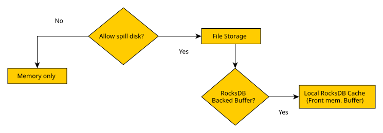

import Tag from '../../component/Tag'
import { Callout } from 'nextra/components'

# Buffer Manager

The Buffer Manager controls temporary data produced while a query executes.
Joins, sorts, grouping, aggregations and other operators may process much more
data than the final result returned to the client.

It keeps intermediate data in memory and, when disk buffering is enabled,
persists batches that no longer fit the in-memory working set.



<Callout type="info">
  Buffer Manager storage and the [query result cache](/engine/cache) solve
  different problems. The buffer supports an active query; the result cache
  reuses a completed result. Buffer files are temporary execution state, not a
  durable application database.
</Callout>

## Configure memory and spill <Tag description={"v26.7+"} />

Buffer settings belong to the application configuration:

```yaml copy
buffer:
  useDisk: true
  encrypt: true
  directory: "/var/lib/kubling/buffer"
  memoryBufferSpaceMb: 512
  maxReservedHeapMb: 256
```

| Property | Purpose | Default when omitted |
| --- | --- | --- |
| `useDisk` | Allows intermediate data to spill to persistent buffer storage | `true` |
| `encrypt` | Enables encryption for engine-managed buffer files | `true` |
| `directory` | Root directory for persistent buffer storage | System temporary directory |
| `memoryBufferSpaceMb` | Fixed memory budget, in MiB, for the engine buffer cache | Calculated automatically |
| `maxReservedHeapMb` | Maximum heap, in MiB, reserved for intermediate query processing before spill | Calculated automatically |

`memoryBufferSpaceMb` must be greater than zero when configured.
`maxReservedHeapMb` must be between `1` and `2097151` MiB. Omitting either
setting preserves automatic sizing.

These are engine query-processing budgets, not a container memory limit. Leave
headroom for the JVM, providers, scripting, result caches and other process
workloads. A fixed budget that fits in isolation can still be unsafe under
concurrent queries.

### Memory-only mode

```yaml copy
buffer:
  useDisk: false
```

Memory-only mode removes the disk fallback. Use it only when the complete
concurrent working set is bounded and fits the available memory. A configured
RocksDB backend is ignored when `useDisk` is `false`.

### Default file-backed mode

```yaml copy
buffer:
  useDisk: true
  directory: "/var/lib/kubling/buffer"
```

This is the default buffering model. For containers, use a writable volume
with enough capacity for the expected concurrent spill rather than relying on
an ephemeral system temporary directory.

## RocksDB-backed buffer

RocksDB can replace the default file-backed persistent buffer while keeping
the same in-memory front. Enable it only with disk buffering:

```yaml copy
buffer:
  useDisk: true
  directory: "/var/lib/kubling/buffer"
  rocksBackedBuffer:
    enabled: true
    maxStorageSpace: 10737418240
    maxOpsPerCommit: 10000
    maxOpenFiles: 1024
    writeBufferSize: 67108864
    backgroundThreads: 2
    inlineLobThresholdBytes: 1048576
```

| Property | Default | Unit | Effect |
| --- | ---: | --- | --- |
| `enabled` | `false` | — | Selects RocksDB instead of the default persistent buffer |
| `maxStorageSpace` | `10737418240` | bytes | Maximum RocksDB buffer storage |
| `maxOpsPerCommit` | `10000` | operations | Batched writes before commit |
| `maxOpenFiles` | `1024` | files | RocksDB open-file limit |
| `writeBufferSize` | `67108864` | bytes | RocksDB memtable size |
| `backgroundThreads` | `2` | threads | Compaction and flush workers |
| `inlineLobThresholdBytes` | `1048576` | bytes | Largest supported LOB kept inside a RocksDB tuple batch |

LOB values above `inlineLobThresholdBytes` use the file store instead of being
inlined into the tuple batch. Increasing the threshold may reduce separate LOB
objects but creates larger batches and can increase memory and serialization
work.

RocksDB-backed buffering is not the
[embedded RocksDB Data Source](/engine/ds/rocksdb). One stores temporary query
batches; the other exposes persistent application tables.

## Observe buffer use

The regular metrics endpoint exposes process-wide Buffer Manager state:

| Metric | Meaning |
| --- | --- |
| `kubling.bm.mem.usage` | Estimated Buffer Manager memory use in MiB |
| `kubling.bm.disk.usage` | Current persistent buffer use in MiB |
| `kubling.bm.disk.write.total` | Persistent write operations since process start |
| `kubling.bm.disk.read.total` | Persistent read operations since process start |

See [Metrics](/observability/metrics#buffer-manager-metrics) for exporter
details.

For query-correlated evidence, enable the
[Performance Tracer](/perf/intro) in a controlled environment. Its
[buffer events](/perf/schema#buffer-events) distinguish logical activity from
successful physical persistence:

- `PHYSICAL_WRITE` records persistence caused by aging
- `SPILL` records persistence caused by memory pressure
- `bytes` is the engine batch-size estimate and `elements` is its row count

Each event is emitted after the first successful persistence of the batch.

## Tune from evidence

Start with automatic memory sizing and the default file-backed buffer. Change
one dimension at a time and compare the same representative workload.

| Observation | Action to evaluate |
| --- | --- |
| Memory grows and disk counters remain zero | Confirm `useDisk`, storage availability and whether the workload has reached spill conditions |
| Frequent spills with acceptable disk capacity | Review concurrent query volume and memory budgets before increasing them |
| Disk usage approaches available capacity | Reduce concurrency, increase the mounted volume or review the RocksDB storage limit |
| A small workload slows after changing backend | Re-test with the default file-backed buffer; persistence is a stability mechanism, not a guaranteed speedup |

The complete configuration reference is available under
[Main Application Configuration](/schemas#main-application-configuration).
