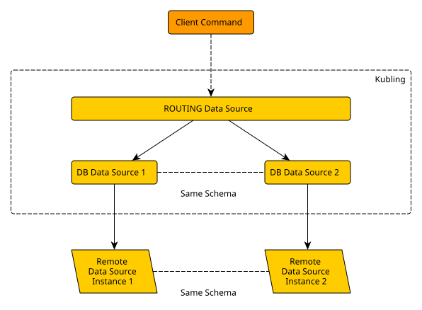
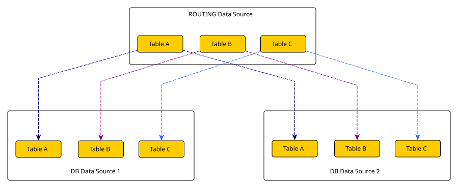

import Tag from '../../../../component/Tag'
import { Callout } from 'nextra/components'

# Routing Data Source (`ROUTING`) <Tag description={"v25.1+"} />

A `ROUTING` Data Source exposes equivalent tables from several Data Sources
through one schema. For each command, it selects one or more of those sources
and combines their results when necessary.

Use it when the same logical table is partitioned by a value such as tenant,
region or environment and clients should not address the physical source
directly.



<Callout type="info">
  `ROUTING` is a proxy. It imports metadata and delegates commands to Data
  Sources already defined in the same VDB; it does not configure their remote
  connections.
</Callout>

## Choose a routing strategy

| Strategy | Use it when | Configuration |
| --- | --- | --- |
| Static rules | The destination can be derived directly from a value in the command | `imports` and `rules` |
| [JavaScript resolver](/engine/ds/routing/javascript) | The destination requires a placement lookup or application-specific policy | `imports` and `resolver` |

The two strategies are mutually exclusive. The following sections describe
static rules.

## Configure static routing

This example exposes the `CLIENT` table from two existing Data Sources and
routes it by `region`:

```yaml copy
- name: "clients"
  dataSourceType: "ROUTING"
  configObject:
    dataSourceName: "clients-routing"
    imports:
      - dataSource: "clients_eu"
        tableNamePattern: "CLIENT"
      - dataSource: "clients_us"
        tableNamePattern: "CLIENT"
    rules:
      - tableNamePattern: "CLIENT"
        field: "region"
        comparison: "EQUAL"
        value: "eu"
        toDataSource: "clients_eu"
      - tableNamePattern: "CLIENT"
        field: "region"
        comparison: "EQUAL"
        value: "us"
        toDataSource: "clients_us"
    strict: true
    limitEnforcement: "PER_ROUTE_AND_UNION"
    orderEnforcement: "POST_UNION"
  schema:
    type: "PHYSICAL"
```

Each `imports` entry selects tables from one Data Source with a regular
expression. Each rule then defines:

| Field | Purpose |
| --- | --- |
| `tableNamePattern` | Routed tables to which the rule applies |
| `field` | Column whose command value is evaluated |
| `comparison` | Comparison against the configured rule value |
| `value` | Configured value used by the comparison |
| `toDataSource` | Imported Data Source selected by the rule |

Static routing uses values supplied by an equality predicate, a non-negated
`IN` predicate or an inserted row. Prepared values are supported.

```sql copy
SELECT id, name, region
FROM clients.CLIENT
WHERE region IN ('eu', 'us')
```

### Multiple matching routes

This query selects both routes. Matching is not a first-rule-wins operation:
all selected routes are used, and their branches are generated in `imports`
order.

Non-equality predicates and `NOT IN` do not provide a safe, finite route set.
If they do not produce another matching value, the command follows the
configured no-match behavior.

## Control unmatched commands

| Configuration | No-match behavior |
| --- | --- |
| `strict: true` | Reject the command |
| `strict: false` with `defaultTo` | Use the named imported Data Source |
| `strict: false` without `defaultTo` | Use the first configured import |

`strict` defaults to `false`. Set `defaultTo` explicitly when the first import
is not the intended fallback.

<Callout type="warning">
  Review fallback behavior before enabling mutations. In non-strict mode, an
  unmatched write can be sent to `defaultTo` or, when it is omitted, to the
  first import.
</Callout>

## Imported table contract

Every imported copy of a routed table must expose the same columns, types and
access-pattern alternatives. Kubling validates this contract when the VDB is
activated and uses the first import as the canonical metadata exposed by the
routing schema.

Access-pattern alternatives are compared by their required columns. Pattern
names, declaration order, column-name case and provider-specific properties do
not need to match. A table without a primary key remains keyless; `ROUTING`
does not synthesize one.



## Reads across routes

When a read selects several routes, Kubling executes one branch per route and
combines the rows with `UNION ALL`.

### `ORDER BY` and `LIMIT` <Tag description={"v25.4.3+"} />

`orderEnforcement` controls where an explicit `ORDER BY` is applied:

| Value | Behavior |
| --- | --- |
| `PER_ROUTE` | Sort each route independently; the combined result is not globally ordered |
| `POST_UNION` | Sort after the routes are combined; this is the default |

`limitEnforcement` controls where an explicit `LIMIT` is applied:

| Value | Behavior |
| --- | --- |
| `PER_ROUTE_ONLY` | Apply the limit to every route; up to `limit × routes` rows can be returned |
| `POST_UNION_ONLY` | Apply the limit only after all route results are combined |
| `PER_ROUTE_AND_UNION` | Apply the limit to every route and again to the combined result; this is the default |

Import order makes branch generation deterministic, but it is not a SQL
ordering guarantee. A query without `ORDER BY` remains unordered.

### Aggregations

An aggregation delegated to `ROUTING` is evaluated independently on each
selected route before the branch rows are combined. If the required result is
global, add an outer aggregation that combines the partial results. For
example, per-route counts can be combined with `SUM`; an average cannot be
combined safely from unweighted per-route averages.

## Joins and access patterns

Each access received by `ROUTING` operates on one routed table. Kubling can
still plan a join outside the routing facade and use values produced by one
side to route dependent accesses on the other side.

This means a routed table does not always need a literal routing predicate.
Prepared values and finite value sets produced by a dependent join can select
routes, and access patterns imported from the underlying Data Sources remain
available to the planner.

See [Access patterns](/providers/access-patterns) and
[Dependent joins](/engine/queries/dependent-joins) for the relationship
between required values, `MAKEDEP` and `MAKEIND`.

If a command containing several named tables reaches `ROUTING` as one source
operation, it is rejected before source I/O. This does not prevent joins that
Kubling decomposes into valid single-table accesses.

## Mutations

`INSERT`, `UPSERT`, `UPDATE` and `DELETE` are allowed only when route selection
produces exactly one destination. Zero routes or several routes are rejected
before any child write because `ROUTING` has no atomic fan-out contract.

Autocommit can use an exact destination directly. Inside an explicit
transaction, the selected Data Source must participate through either
[native Data Source transactions or Soft Transactions](/engine/tx/intro). For
a source without native transaction support, enable Soft Transactions. Bulk
routed mutations are rejected because their rows may select different
destinations; split them into single-route statements.

## Internal query capacity <Tag description={"v26.7+"} />

Routed reads use the shared internal query pool. Its defaults are suitable for
most deployments, but operators can bound concurrency and wait time in the
application configuration:

```yaml copy
internalQueryPool:
  maxConnectionsPerVdb: 10
  maxWaitMilliseconds: 30000
```

Both values must be greater than zero. Increase them only after confirming
that concurrent routed operations are waiting for the pool and that the
deployment has capacity for the additional internal connections.

The complete field reference is available in
[Routing Data Source Configuration](/schemas#routing-data-source-configuration)
and [Main Application Configuration](/schemas#main-application-configuration).
