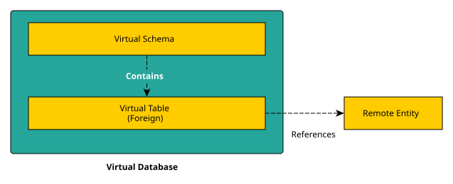

# Virtual Database (VDB)

A Virtual Database (VDB) is a versioned metadata and execution boundary. It
combines one or more data sources into a single catalog that clients can query
through Kubling's supported SQL transports.

A VDB contains data sources, each data source contributes a schema, and each
schema contains tables. Those tables describe remote entities; they do not
require the source system to use a relational storage model.

The VDB is therefore an overlay: it can expose source entities directly or
adapt them to the names, types and relationships required by clients without
changing the source systems.

The term *entity* covers the remote counterpart of a Kubling table, including a
database table, document collection, object repository, API resource or
provider-defined object.
